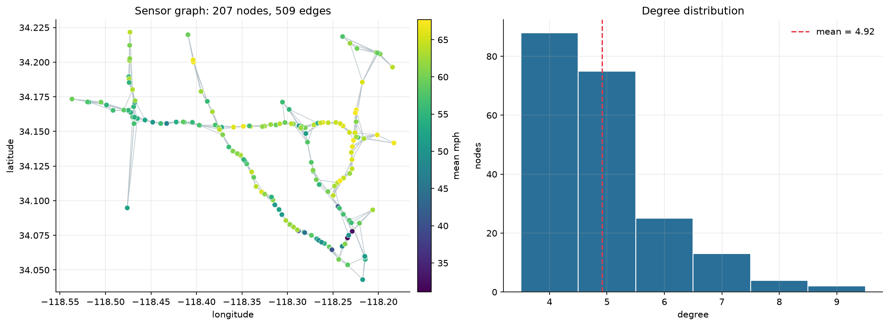
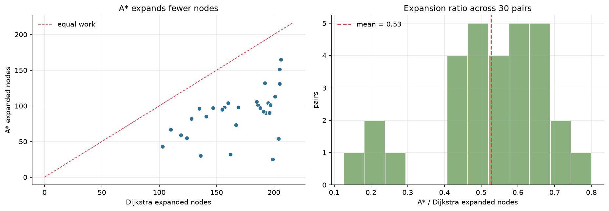
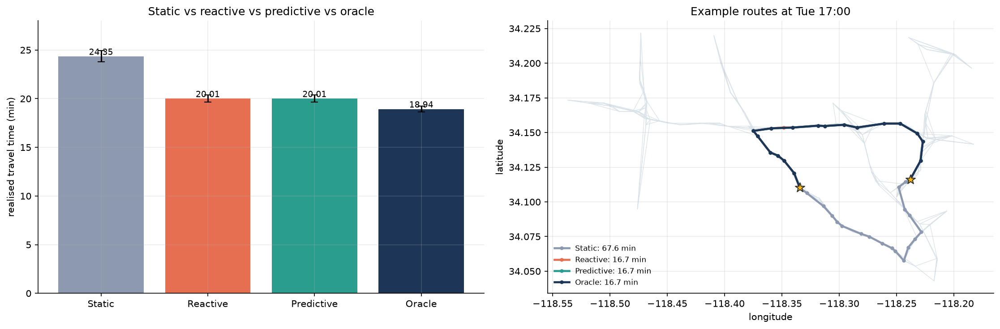
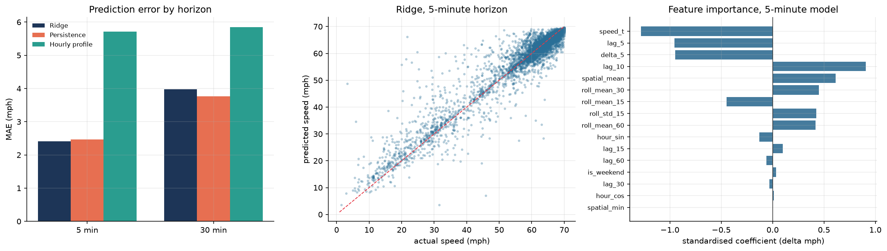

# Dynamic Graph-Based Traffic Optimization Using Machine Learning

End-to-end traffic-network analysis on the **METR-LA** freeway sensor dataset:

- data quality analysis and chronological preprocessing,
- exploratory traffic analysis,
- KNN graph construction over 207 sensors,
- custom **Dijkstra** and **A\*** shortest-path algorithms,
- traffic-dependent edge weights (travel time in minutes),
- **16-feature ridge regression** for future speed prediction,
- static / reactive / predictive / oracle route comparison,
- independent verification against **NetworkX**.

The complete, executed implementation is in:

**`Project1_Dynamic_Graph_Traffic_Optimization.ipynb`**

## Quick start

```bash
pip install -r requirements.txt
jupyter notebook Project1_Dynamic_Graph_Traffic_Optimization.ipynb
```

Run all cells. The notebook auto-detects the three METR-LA files in `data/`:

```
data/metr-la.h5
data/graph_sensor_locations.csv
data/distances_la_2012.csv
```

If they are absent, it uses a deterministic **synthetic surrogate** with the same shape
(34,272 × 207) and realistic rush-hour, spatial-correlation, incident and missing-value behaviour.
The output always states which source was used. See `data/README.md` for download links.

## What the notebook contains

| Section | Content |
|---|---|
| §5 | METR-LA loading, zero→NaN, interpolation, 70/10/20 chronological split |
| §6 | speed distribution, hourly patterns, weekday/weekend, heatmap, sensor map |
| §7 | adjacency-list graph, K = 4 nearest sensors, connectivity repair, components/diameter |
| §8 | Dijkstra with binary heap, lazy deletion, early termination |
| §9 | A\* with admissible Haversine heuristic, 30-pair benchmark |
| §10 | dynamic edge weights `w_ij(t) = 60 D_ij / mean speed` |
| §11 | 16-feature ridge regression, persistence and hourly-profile baselines, MAE/RMSE |
| §12 | static vs reactive vs predictive vs oracle routing on realised future travel time |
| §13 | NetworkX cross-check, complexity summary |
| §14–18 | findings, repository layout, limitations, reproducibility checklist |

## Key design choices

- **No library does the algorithms.** Dijkstra, A\*, the graph structure, BFS and ridge regression
  are implemented with plain Python + NumPy. NetworkX is used only as a referee.
- **Data is real when present.** The loader prefers the three real METR-LA files in `data/`; the
  synthetic surrogate is only a labelled fallback for a machine without the dataset.
- **No interpolation leakage.** The split happens before imputation; validation and test use only
  causal forward-fill from the past.
- **Fair routing comparison.** Every strategy chooses a route at time `t` using only information
  available then; all routes are scored with the same actual `t + 30 min` speeds.
- **Honest reporting.** Ridge regression is compared against persistence and an hourly profile;
  where it loses, the notebook says so.
- **Sensor graph, not navigation.** METR-LA gives sensor locations and sensor-to-sensor distances,
  not lane-level road geometry. This is documented as a limitation.

## Results at a Glance

### Graph Analysis
| Metric | Result |
|---|---:|
| Nodes | 207 |
| Edges | 509 |
| Connected Components | 1 |
| Graph Diameter | 21 hops |

### Dijkstra vs A*
Evaluated on 30 origin-destination pairs.

| Metric | Result |
|---|---:|
| Identical route costs | 30/30 |
| A* node expansions | 52.7% of Dijkstra |

### Traffic Prediction (Test MAE)

| Horizon | Ridge Regression | Persistence | Hourly Profile |
|---|---:|---:|---:|
| 5 minutes | 2.412 mph | 2.469 mph | 5.710 mph |
| 30 minutes | 3.974 mph | 3.760 mph | 5.853 mph |

### Routing Comparison

| Strategy | Mean Travel Time |
|---|---:|
| Static | 24.350 min |
| Reactive | 20.010 min |
| Predictive | 20.015 min |
| Oracle | 18.937 min |

Traffic-aware routing reduced simulated travel time
by approximately 17.8% compared with static routing.

Note: Predictive routing did not meaningfully outperform
reactive routing in this experiment.

## Visualizations

### Traffic Sensor Network


### Dijkstra vs A*


### Dynamic Routing


### Machine Learning Evaluation


## Outputs
Running the notebook writes:

```
figures/                                   # all figures
results/prediction_metrics/                # ridge vs baseline metrics, lambda selection
results/routing_comparison/                # raw runs and strategy summary
results/algorithm_benchmarks/              # A* vs Dijkstra, NetworkX verification
results/summary_metrics.json               # headline metrics
```
## Visualization Gallery

### 1. Traffic Sensor Network
Visual representation of the constructed freeway sensor graph.


### 2. Shortest Path Algorithm Comparison
Comparison of Dijkstra and A* across multiple origin-destination pairs.


### 3. Machine Learning Evaluation
Performance analysis of Ridge Regression against baseline prediction methods.


### 4. Dynamic Route Optimization
Comparison of static, reactive, predictive and oracle routing strategies.


## Repository layout

```
.
├── Project1_Dynamic_Graph_Traffic_Optimization.ipynb   # executed notebook (main artefact)
├── data/
│   └── README.md
├── figures/
├── results/
├── requirements.txt
└── README.md
```

The notebook is intentionally self-contained. The module split proposed in the project
specification (`src/data_loader.py`, `src/dijkstra.py`, etc.) maps one-to-one onto its sections and
can be extracted later without changing the algorithms.

## Limitations

1. Routes are computed on a traffic-sensor graph, not a turn-by-turn road map.
2. Training uses offline linear interpolation; validation and test use causal forward-fill only,
   so no future test observation fills an earlier value.
3. The surrogate fallback is labelled and is not a substitute for real METR-LA measurements.
4. Ridge regression is linear; its advantage over persistence narrows at longer horizons and can
   reverse on real data.
5. Edge speed is the mean of the two endpoint sensors; within-link variation is ignored.
6. Routes are chosen once at departure and not replanned en route.
7. The oracle strategy uses actual future speeds and is not deployable.
